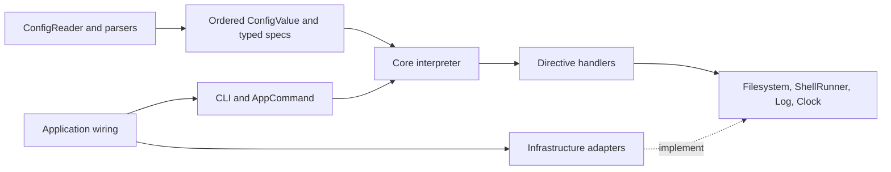

# Architecture

`dotbot-scala` uses a small ports-and-adapters architecture. Domain types and policies stay independent of parser, filesystem, terminal, and CLI libraries. Golden tests preserve normal CLI behavior; safety changes have explicit regression coverage.

## Current Shape

- `io.worxbend.dotbot.core` owns the domain model (`ConfigValue`, `Action`, `Task`), directive enums, typed directive specs, planning output, execution outcome, and directive handlers.
- `io.worxbend.dotbot.config` owns file reading and parsing. It parses YAML with `virtuslab/scala-yaml`, HOCON with Lightbend Config, JSON with an ordered jsoniter codec, and TOML with `tomlj`.
- `io.worxbend.dotbot.fs`, `shell`, and `logging` provide injected runtime ports and adapters.
- `io.worxbend.dotbot.core.Environment` abstracts the ambient process environment, so path
  expansion and terminal detection are functions of injected values rather than of global state.
- `io.worxbend.dotbot.app` wires dependencies, selects the app command, and renders plan output; `cli` maps picocli parse results to immutable app options.

Mill enforces three modules with matching physical source roots: `core/src`, `infra/src`, and `app/src`. Package names remain stable. Sources use Mill's default module layout instead of environment-derived absolute paths. `core` has no third-party dependencies; `infra` depends on `core`; `app` depends on both. Tests remain in `app/test/src` so `./mill app.test` checks the complete boundary.

## Responsibility and pattern choices

- `DirectiveHandler` is a strategy selected by the registry. `BatchedDirectiveHandler` supplies the small shared execution template. New directives do not require inheritance across infrastructure layers.
- `ConfigDecoder[A]` is the typed decoding boundary. `DirectiveDefaults.decode` validates a whole defaults block before unknown names or invalid shapes could be discarded. Apply's compatibility conversion remains explicit.
- `LinkHandler` resolves sources, evaluates conditions, expands globs, and creates links. Its `LinkDestination` collaborator owns destination preparation: source protection, parent creation, backup, and removal. Preparation returns a named result and stops at the first failure.
- `ConfigLoader`, `Filesystem`, `ShellRunner`, and `Log` are ports. Adapters implement the ports; application wiring supplies them. The application no longer requires a concrete `ConfigReader` in its dependency contract.
- `CliState` is immutable. A builder, local to each Picocli invocation, collects mutations. It needs no atomic synchronization. Option declarations remain in `Cli.scala`.
- `AppCommand` selects apply, validation, or output behavior. `PlanOutput` renders data without executing it. Terminal escaping is an infrastructure concern and does not alter JSON values.

Use composition where a policy varies. Keep simple transformations as functions. Additional factories, effect frameworks, service locators, or inheritance trees would add no concrete capability to this CLI.

## Execution and safety contracts

The configuration is an ordered program. Defaults and later actions are deliberately sequential; running directives concurrently could change their meaning. `Outcome` accumulates independent failures. It must never be used to continue a sequence of dependent destructive operations after a prerequisite fails.

Directory modes distinguish omission (`None`, preserve umask) from an explicit mode. Backup moves refuse replacement. Failed backups or destination inspections prevent deletion. Source identity and canonical containment checks prevent backing up the source itself or deleting its containing directory. Force replacement is still an explicitly destructive operation, and the whole run is not transactional.

Malformed globs and invalid paths become typed errors. Shell start failures are distinct from a command's exit status; a timed-out link condition fails instead of silently skipping the link. The shell adapter scopes streams and process cleanup with `try/finally` around its Ox supervision.

`plan` is a validated summary of configuration intent. It does not evaluate conditions, simulate prior filesystem changes, or enumerate every glob match. `--dry-run` inspects the current filesystem and predicts actions without mutations or shell execution. It cannot promise that an actual run against changed filesystem state will succeed.

## Performance and build contracts

Ordinary globs limit traversal depth. Exclusions are compiled once and matched against included candidates, avoiding one filesystem walk per exclusion. Results remain sorted. Quiet logging does not evaluate suppressed messages, including large glob debug descriptions.

The application depends on `ujson`, the API it uses, rather than the broader upickle serialization bundle. Both Scala and Java target Java 21; warnings are errors in local and CI builds. Formatting checks, lint, tests, and packaged smoke checks are separate commands. Build and dependency versions remain pinned to the existing versions.

See [the review](docs/REVIEW.md) for measurements and [security assumptions](docs/SECURITY.md) for filesystem concurrency and trusted-shell limits.

## Interpretation Model

Configuration is treated as a program:

- Config parsers produce a core `ConfigValue` AST and ordered `Task`/`Action` values.
- `ConfigDecoder` instances decode raw config values into typed directive specs.
- Directive handlers plan and execute typed directive specs.
- Plan and validate modes interpret the decoded directives without filesystem changes.
- Apply mode interprets the same directives through injected filesystem, shell, logger, and clock ports.

This keeps observable behavior stable while allowing fast unit tests against fake ports and golden integration tests against the app edge.

## Decision Log

- TS-1: Directive names are represented by `Directive` instead of raw strings. Unknown directives are represented explicitly.
- TS-2: Link type is represented by `LinkType` instead of raw strings.
- TS-3: App mode is represented by `RunMode` and `OutputFormat` instead of boolean mode pairs plus output strings.
- TS-4: Config read/parse, decode, validation, planning, execution, glob, link-option, and unknown-action failures flow through `DotbotError`; rendering remains at the app edge.
- TS-5: Directive execution now returns `Outcome` instead of `Boolean` for soft failure accumulation.
- TS-6: Link backup/delete results use named result enums instead of boolean tuples.
- TS-7: Shell execution returns `ShellExit`, with `TimedOut` as a case distinct from `Completed(exitCode)` so a
  timeout is never confused with a command that chose to exit non-zero.
- TS-8: File modes use the opaque `FileMode` type.
- PV-1: `ConfigDecoder` instances decode each action into typed specs through shared shape/field combinators before plan/execute paths.
- PV-2/PV-3: The old `Values` helper was replaced with `ConfigValue` extension methods and directive decoders; strict decoding now surfaces bad list and mode values.
- ST-1: Runtime defaults are folded explicitly through dispatch/plan state instead of living in mutable context state.
- ST-2: The interpreter and directive handlers accumulate execution success with `Outcome` folds instead of mutable or folded success booleans.
- ST-3: Logger configuration is immutable after construction.
- ST-4: CLI state uses immutable snapshots after picocli setter collection; raw argument rescans were removed.
- SD-1/SD-2: Directive handlers are classes registered by `Directive` in the composition root.
- SD-3: Defaults handling is explicit in interpreter state.
- SD-4: `DotbotApp` delegates command behavior to `AppCommand` and wiring helpers.
- SD-5: Summary logging is handled through `Outcome.withSummary`.
- SD-6: Plan rendering lives at the app edge and uses operation detail styles instead of directive-string switches.
- SD-7: Build version is generated by Mill `BuildInfo`, with environment override preserved.
- DC-1/DC-2: Dead path normalization was removed and environment expansion regex is hoisted.
- DC-3/DC-4: Glob walking was unified and double-star directory filtering is named and tested.
- DC-5: POSIX permissions are mapped directly from mode bits.
- DC-6: Config file path handling was simplified in `ConfigReader`.
- DC-7: Independent `Either` traversals use `EitherUtil.traverse`; the remaining interpreter fold carries defaults state.
- DC-8: Logger label padding is locked by tests as output contract.
- BT-1/BT-5: Golden tests, fake-backed handler tests, and property tests now form separate test tiers.
- BT-2: Strict scalac warnings and `-Werror` apply in local and CI builds; Scala and Java target release 21.
- BT-3: Scalafix is wired for `core.fix --check` with `OrganizeImports` and core-only `DisableSyntax` rules for `var`, `return`, and `null`.
- BT-4: The Mill module graph and physical directories are split into `core`, `infra`, and `app`; `core` has no Maven dependencies.
- BT-6: `munit-scalacheck` covers selected path, glob, and permission invariants.
- DI-1: Ambient process state is reached through an `Environment` port. `Environment.System` is the
  only code that touches `sys.env` or `sys.props`, and it is supplied at the composition root. This
  exists for testability first: expansion rules that read global state cannot be exercised without
  mutating the whole JVM, which also prevents such tests from running in parallel.
- DI-2: `PathUtil` holds only path algebra that depends on its arguments; expansion and resolution
  live in `PathResolver`, which takes an `Environment` and is carried on `RuntimeContext`.
  `absFromExpanded` exists so that recursive walks do not expand real directory entries a second
  time.
- DI-3: Terminal rendering capability is a `TerminalCapabilities` value derived by a pure function
  of the environment plus whether a console is attached, injected through `AppDependencies`,
  replacing the self-detecting `ColorSupport` and `SymbolSupport`.
- OUT-1: The logger takes an output stream and an error stream. Warnings and errors go to the
  error stream so machine-readable output on stdout cannot be corrupted by diagnostics.
- VAL-1: Each directive declares an `OptionSchema` naming the options it accepts and the type of
  each. Strict (validate) decoding checks entries and `defaults` sections against it; execute mode
  stays lenient so that working configurations are unaffected.
- VAL-2: Directive entries that cannot be decoded carry a description of what was written, so a
  soft failure can name the offending entry rather than only appearing in the summary.
